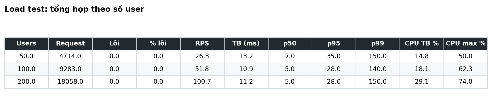
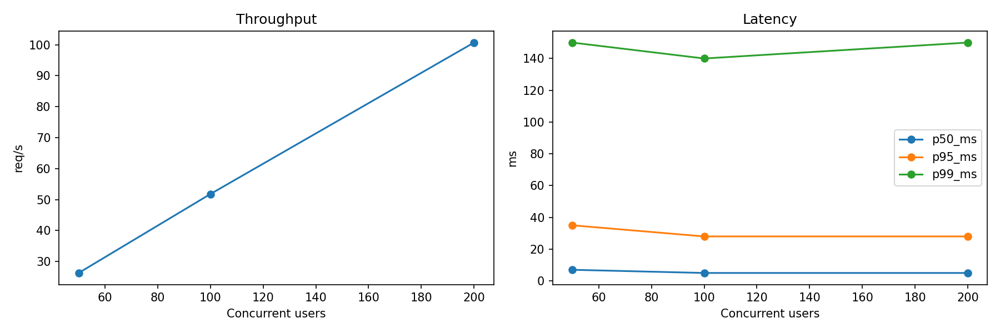
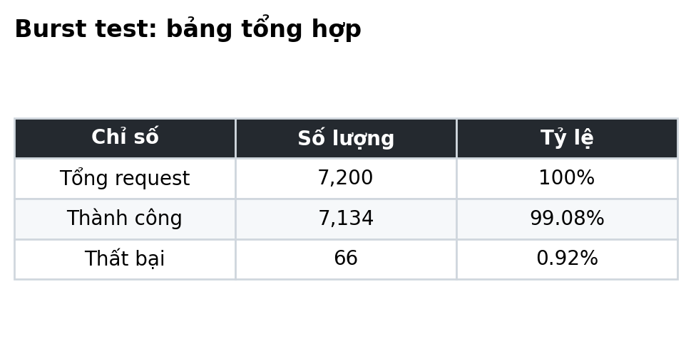
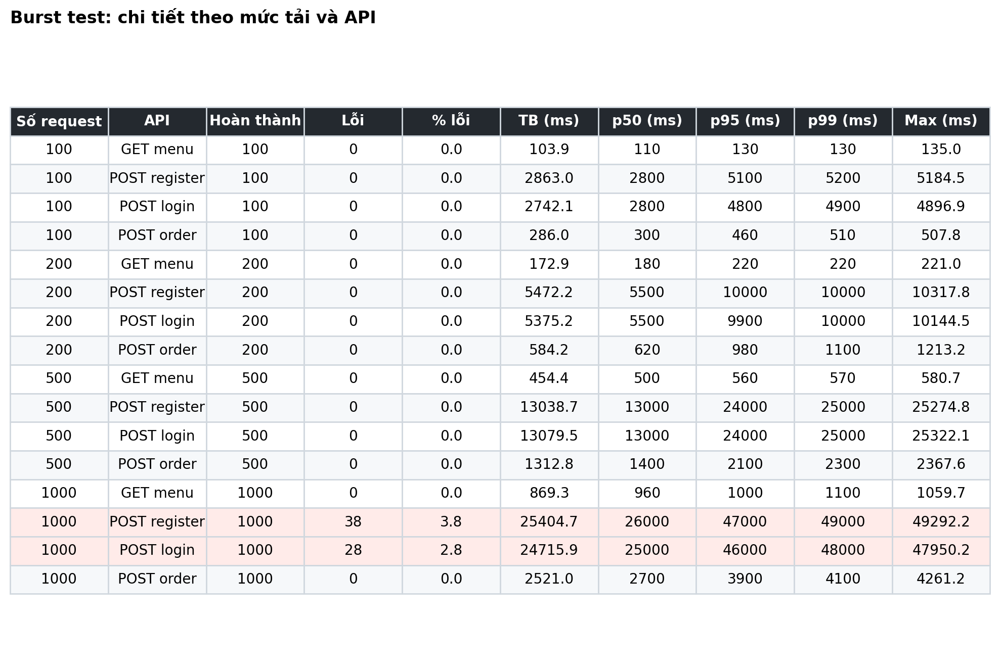
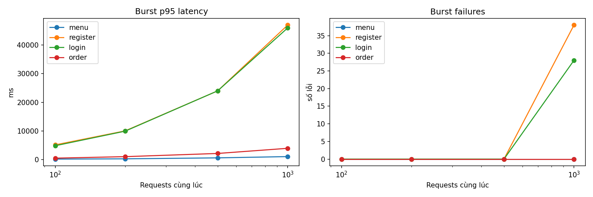

# Coffee Shop Order Management

Backend REST API quản lý đặt món cho quán cà phê.

## 1. Giới thiệu

Hệ thống giúp quán cà phê nhận và quản lý đơn hàng qua API. Có 3 nhóm người dùng:

| Vai trò | Chức năng |
| --- | --- |
| Khách (chưa đăng nhập) | Xem danh mục và thực đơn |
| `CUSTOMER` | Đăng ký, đăng nhập, đặt món, áp voucher, xem/hủy đơn của mình, xem hóa đơn |
| `ADMIN` | Quản lý món (thêm/sửa/xóa mềm), tạo voucher, xác nhận đơn, xem và hủy mọi đơn |

### Luồng hoạt động

1. Khách xem thực đơn (lọc theo danh mục, tìm theo tên).
2. Khách đăng ký tài khoản, mặc định sẽ là `CUSTOMER`, đăng nhập bằng email và nhận JWT.
3. Khách tạo đơn: chọn món, số lượng, có thể nhập mã voucher để giảm giá và có thể nhập ghi chú cho đơn (VD: ít đá). Hệ thống kiểm tra các món còn hàng, voucher còn hạn, lưu lại giá tại thời điểm đặt và tính tổng tiền cuối cùng. Đơn ở trạng thái `PENDING`.
4. Admin xác nhận đơn (`PENDING → CONFIRMED`). Tài khoản Admin không thể đăng ký mà dược tạo sẵn và chỉ có quán mới biết được thông tin của tài khoản Admin.
5. Chủ đơn hoặc admin có thể hủy đơn (`PENDING → CANCELLED`). `CANCELLED` là trạng thái cuối. Đơn chỉ có thể bị huỷ khi đang `PENDING`. `CONFIRM` là trạng thái mà Admin đã xác nhận đơn và quán đã đang chuẩn bị nên khi đó đơn không thể huỷ được nữa.
6. Khách đã đăng nhập có thể xem lại đơn và hóa đơn (subtotal, giảm giá, thuế, tổng).

### Quy tắc nghiệp vụ
- Giá món được **chụp lại** vào đơn; đổi giá menu sau đó không ảnh hưởng đơn cũ.
- Tổng tiền được tính **một lần** khi tạo đơn và lưu lại; hóa đơn trả về giá trị đã lưu.
- Món phải tồn tại, đang hoạt động (`is_active = true` tức là quán vẫn còn đang bán) và còn hàng (`available`), nếu không cả đơn bị từ chối. Số lượng ≥ 1.
- Voucher hợp lệ khi tồn tại, đang hoạt động và chưa hết hạn; giảm 1–100%.
- Xóa món là **xóa mềm** (`is_active = false`).

Cách tính tiền (`BigDecimal`, làm tròn 2 chữ số `HALF_UP`):

```
subtotal = Σ(đơn giá × số lượng)
discount = subtotal × discount_percent / 100
tax      = (subtotal − discount) × TAX_RATE
total    = subtotal − discount + tax
```

## 2. Tech stack

| Thành phần | Công nghệ |
| --- | --- |
| Ngôn ngữ / framework | Java 25, Spring Boot 4.1 (Web MVC, Security, Data JPA, Validation) |
| Database | MySQL 8.4, Hibernate |
| Xác thực | JWT (JJWT 0.12.6, HS256), BCrypt |
| Khác | MapStruct, Lombok, springdoc-openapi (Swagger) |
| Đóng gói / kiểm thử tải | Maven, Docker Compose, Kaggle CPU |

## 3. API

Tất cả endpoint bắt đầu bằng `/api`, tổng cộng có 17 endpoint. Tài liệu chi tiết xem tại Swagger UI (http://localhost:8080/swagger-ui/index.html).

| Method | Endpoint | Quyền | Mô tả |
| --- | --- | --- | --- |
| POST | `/auth/register` | Công khai | Đăng ký `CUSTOMER` |
| POST | `/auth/login` | Công khai | Đăng nhập, trả về `access_token` |
| GET | `/users/me` | Đã đăng nhập | Thông tin tài khoản hiện tại |
| GET | `/categories` | Công khai | Danh sách danh mục |
| GET | `/menu-items` | Công khai | Danh sách món (lọc `category_id`, `keyword`, phân trang) |
| GET | `/menu-items/{id}` | Công khai | Chi tiết món |
| POST | `/menu-items` | `ADMIN` | Thêm món |
| PUT | `/menu-items/{id}` | `ADMIN` | Sửa món |
| DELETE | `/menu-items/{id}` | `ADMIN` | Xóa mềm món |
| POST | `/orders` | Đã đăng nhập | Tạo đơn |
| GET | `/orders` | Đã đăng nhập | Đơn của mình (admin xem tất cả), phân trang |
| GET | `/orders/{id}` | Chủ đơn / `ADMIN` | Chi tiết đơn |
| GET | `/orders/{id}/bill` | Chủ đơn / `ADMIN` | Hóa đơn |
| POST | `/orders/{id}/cancel` | Chủ đơn / `ADMIN` | Hủy đơn |
| POST | `/orders/{id}/confirm` | `ADMIN` | Xác nhận đơn |
| POST | `/vouchers` | `ADMIN` | Tạo voucher |
| GET | `/vouchers/{code}` | Đã đăng nhập | Tra cứu voucher |

JSON dùng `snake_case`. Mọi phản hồi thành công có dạng `{ "status_code", "message", "data" }`; lỗi có dạng `{ "status_code", "code", "error", "message", "path", "timestamp" }`.

## 4. Database


| Bảng | Nội dung |
| --- | --- |
| `users` | Tài khoản, mật khẩu BCrypt, vai trò |
| `categories` | Danh mục (VD: Coffee, Tea, Cake) |
| `menu_items` | Món, giá, trạng thái còn hàng; thuộc 1 danh mục |
| `vouchers` | Mã, phần trăm giảm giá, hạn dùng |
| `orders` | Đơn hàng: trạng thái và các khoản tiền đã lưu; thuộc 1 user, có thể có 1 voucher |
| `order_items` | Món trong đơn: tên và đơn giá chụp lại, số lượng |

Mọi bảng dùng khóa UUID và có các cột audit (`created_at`, `created_by`, ...) cùng cờ `is_active`. Schema và dữ liệu mẫu nằm ở [`01-schema.sql`](infrastructure/database/init/01-schema.sql).

## 5. Kiến trúc


Hệ thống là một **monolith Spring Boot** và một **MySQL**, chạy bằng Docker Compose. Bên trong chia lớp một chiều:

```
Request → JwtAuthFilter → Controller → Service → Repository → MySQL
```

- **Filter** (`JwtAuthFilter`): kiểm tra token, gán quyền `ROLE_CUSTOMER`/`ROLE_ADMIN`. Quy tắc phân quyền tập trung ở `SecurityConfig`.
- **Controller**: chỉ xử lý HTTP (nhận request, validate, trả `ApiResponse`).
- **Service**: toàn bộ nghiệp vụ và transaction, không phụ thuộc web/servlet. Kiểm tra quyền sở hữu đơn nằm ở đây; tính tiền tách riêng trong `OrderPricing`.
- **Repository**: Spring Data JPA.
- **Dùng chung**: `GlobalExceptionHandler` chuẩn hóa lỗi, MapStruct chuyển entity ↔ DTO.

## 6. Cách chạy

Yêu cầu: JDK 25, Docker (Compose v2).

```bash
cp .env.example .env
openssl rand -base64 32        # dán kết quả vào JWT_SECRET trong .env

docker compose up -d --build   # chạy cả MySQL và app
```

Hoặc có thể chạy app bằng Maven (MySQL vẫn chạy trong Docker):

```bash
docker compose up -d db
set -a; source .env; set +a
./mvnw spring-boot:run
```

- API: http://localhost:8080/api/menu-items
- Swagger UI: http://localhost:8080/swagger-ui/index.html
- Tài khoản admin: `ADMIN_EMAIL` / `ADMIN_PASSWORD` trong `.env`
- Chạy test: `./mvnw test`
- Kiểm thử tải: script Locust và notebook Kaggle trong thư mục [`loadtest/`](loadtest/)

Nếu sửa `01-schema.sql`, cần tạo lại volume: `docker compose down -v && docker compose up -d db`.

## 7. Kiểm thử tải

Kiểm thử bằng Locust trên Kaggle CPU, app và MySQL chạy cùng máy. Dữ liệu thô (CSV, báo cáo HTML) nằm trong thư mục [`results/`](results/).

### Load test: tải ổn định

Mô phỏng 50, 100 và 200 người dùng đồng thời: phần lớn là khách xem menu, phần còn lại đăng ký, đăng nhập, đặt đơn và xem hóa đơn.





Ở cả 3 mức tải **không có lỗi**, throughput tăng tuyến tính theo số user (26 → 101 req/s), p95 giữ ở khoảng 28–35 ms. CPU của app tối đa 74% ở 200 user.

### Burst test: nhiều request cùng lúc

Gửi đồng thời 100, 200, 500 và 1000 request vào từng API: xem menu, đăng ký, đăng nhập, tạo đơn.







Xem menu và tạo đơn không lỗi ở mọi mức, p95 ở 1000 request lần lượt là 1 s và 3,9 s. Đăng ký và đăng nhập chậm nhất (p95 khoảng 46–47 s ở 1000 request) và là hai API duy nhất phát sinh lỗi (66/7.200 request, 0,92%, đều là HTTP 500). Hai API này phải băm/kiểm tra mật khẩu BCrypt, tốn nhiều CPU nên request bị dồn hàng đợi khi tải lớn.

## 8. Đề xuất cải tiến cho Phase 2

Dưới đây là những điểm **nhóm đề xuất** có thể cải tiến, dựa trên hiện trạng của Phase 1:

| Hướng | Hiện trạng | Đề xuất |
| --- | --- | --- |
| Chi phí xác thực | `JwtAuthFilter` truy vấn user từ MySQL ở mỗi request | Dùng thông tin trong token hoặc cache user trong thời gian ngắn |
| Cache | Menu và danh mục được đọc nhiều nhưng luôn phải truy vấn DB mỗi lần xem mặc dù ít bị thay đổi| Cache menu/danh mục, xóa cache khi admin sửa |
| Indexing | `orders` chỉ có index khóa ngoại; tìm món dùng `LIKE '%kw%'` | Index `orders(user_id, created_at)`, `orders(status, created_at)`; full-text cho tên món |
| Mở rộng | Một instance app và một MySQL có thể trở thành điểm tắc nghẽn nếu 1 trong 2 không hoạt động dẫn đến ảnh hưởng của cả hệ thống và quán sẽ buộc phải dừng hoạt động | Mở rộng nhiều instance sau Nginx, Sử dụng Redis, MySQL read replica |
| Xử lý đồng thời | Xác nhận và hủy cùng một đơn có thể ghi đè nhau | Optimistic locking (`@Version`) cho `orders` |
| Áp dụng thêm design pattern | Hiện tại luật trạng thái đang ở `OrderStatus`, logic tạo đơn trong `OrderServiceImpl` | Có thể áp dụng state pattern cho trạng thái đơn, Factory cho tạo đơn |
| Bảo vệ API | Chưa có phương pháp để phòng chống DoS/DDoS |Rate limit và chống DoS/DDoS|
| Nghẽn ở đăng nhập/đăng ký | Burst test cho thấy hai API này chậm nhất (p95 khoảng 46–47 s ở 1000 request) và là nơi duy nhất phát sinh lỗi 500, vì BCrypt (cost 10) tốn CPU và các request xếp hàng chờ không giới hạn | Bulkhead: giới hạn số request băm mật khẩu chạy cùng lúc (khoảng bằng số nhân CPU), vượt ngưỡng thì trả 503 ngay thay vì chờ lâu rồi lỗi; tách luồng xử lý đăng nhập khỏi các API khác để menu và đặt đơn không bị ảnh hưởng |
