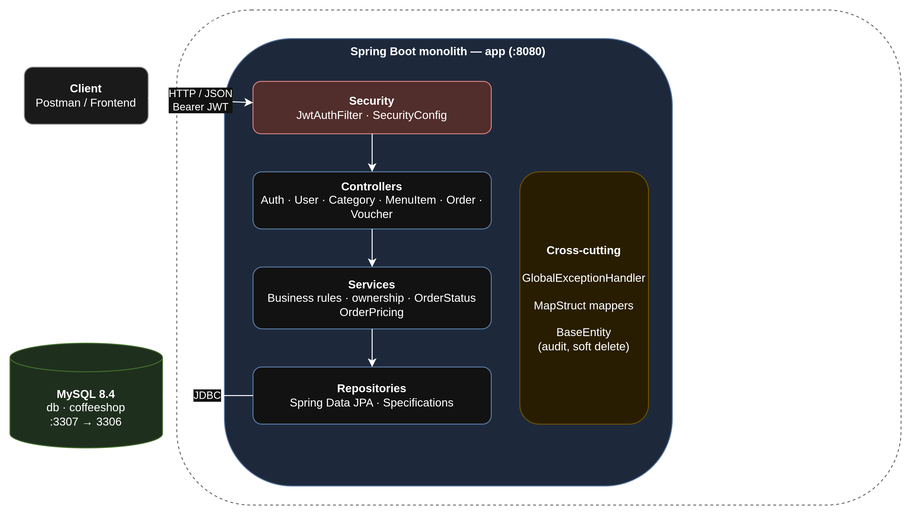
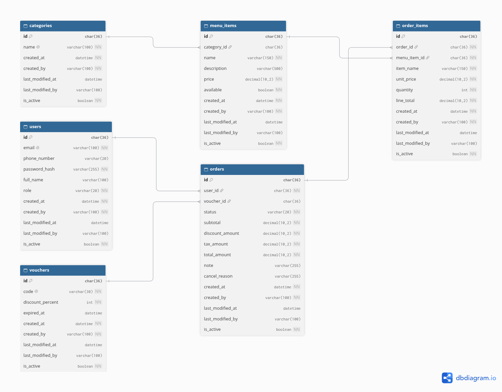

# Coffee Shop Order Management

A REST backend for a coffee shop: guests browse the menu, customers place orders and apply vouchers, and admins manage the menu and vouchers and confirm orders. Built for the **Architecture Solution** course.

## Table of contents

- [What it does](#what-it-does)
- [Architecture](#architecture)
- [Database](#database)
- [Tech stack](#tech-stack)
- [Getting started](#getting-started)
- [API reference](#api-reference)
- [Business rules](#business-rules)
- [Repository layout](#repository-layout)
- [Roadmap](#roadmap)
- [Load test](#load-test)

## What it does

| Area | Capability |
| --- | --- |
| Accounts | Register (always as `CUSTOMER`) and log in with email + password. Passwords are BCrypt hashed. Login returns a stateless JWT access token (24 hours by default). |
| Menu | Anyone can browse categories and menu items. Admins create, update and soft-delete menu items. |
| Orders | Customers create orders from available menu items, with an optional voucher and note. Prices are snapshotted into the order, and totals (subtotal, discount, tax, total) are computed once and stored. |
| Order lifecycle | `PENDING → CONFIRMED` (admin), `PENDING/CONFIRMED → CANCELLED` (owner or admin). `CANCELLED` is final. |
| Vouchers | Admins create percentage vouchers; authenticated users look up a voucher by code. |
| Operations | Swagger UI / OpenAPI docs, Docker packaging. |

## Architecture



The runtime consists of two containers started by `docker-compose.yml`:

| Component | Role |
| --- | --- |
| **Spring Boot monolith** (`app`, `:8080`) | REST API, security, business logic. Creates the first `ADMIN` account at startup (`AdminInitializer`). |
| **MySQL 8.4** (`db`, host `:3307` → `3306`) | Database `coffeeshop`. Schema and seed data come from `infrastructure/database/init/01-schema.sql`; Hibernate does not touch the schema (`ddl-auto: none`). |

Inside the monolith, requests flow through strict layers (**controller → service → repository**, never skipping one):

1. **Security**: `JwtAuthFilter` reads the `Authorization: Bearer …` header, validates the HS256 token and sets `ROLE_CUSTOMER` / `ROLE_ADMIN`. Role rules live centrally in `SecurityConfig`; 401/403 responses come from `CustomAuthenticationEntryPoint` / `CustomAccessDeniedHandler`.
2. **Controllers** (`controller/`): thin REST endpoints: `Auth`, `User`, `Category`, `MenuItem`, `Order`, `Voucher`.
3. **Services** (`service/`, `service/impl/`): business rules and transactions, free of web/servlet classes. Ownership checks ("is this order mine?") happen here; status transitions are delegated to the `Order` entity, which validates them with `OrderStatus.canTransitionTo`. Pricing is isolated in `util/OrderPricing`.
4. **Repositories** (`repository/`): Spring Data JPA interfaces; filtering and paging use JPA Specifications (`MenuItemSpecifications`, `OrderSpecifications`).
5. **Cross-cutting**: `GlobalExceptionHandler` turns `AppException(ErrorCode)` into a uniform `ErrorResponse`; MapStruct mappers convert entities ↔ DTOs; `BaseEntity` adds JPA audit columns and the `is_active` soft-delete flag.

## Database



Six tables, all with `CHAR(36)` UUID primary keys and the audit columns `created_at`, `created_by`, `last_modified_at`, `last_modified_by`, `is_active` inherited from `BaseEntity`:

| Table | Purpose | Key relations |
| --- | --- | --- |
| `users` | Credentials, profile, single `role` (`CUSTOMER` / `ADMIN`) | — |
| `categories` | Menu categories (Coffee, Tea, Cake) | — |
| `menu_items` | Name, description, price, `available` flag | `category_id → categories` |
| `vouchers` | Unique `code`, `discount_percent`, optional `expired_at` | — |
| `orders` | Status, stored `subtotal`, `discount_amount`, `tax_amount`, `total_amount`, note, cancel reason | `user_id → users`, `voucher_id → vouchers` |
| `order_items` | Snapshot of `item_name`, `unit_price`, `quantity`, `line_total` | `order_id → orders`, `menu_item_id → menu_items` |

The source of the diagram is [`docs/database/database.dbml`](docs/database/database.dbml) (paste it into [dbdiagram.io](https://dbdiagram.io) to edit and export).

## Tech stack

| Concern | Choice |
| --- | --- |
| Language | Java 25 |
| Framework | Spring Boot 4.1.1 (Web MVC, Security, Data JPA, Validation) |
| Persistence | Hibernate + MySQL 8.4 |
| Auth | JJWT 0.12.6 (HS256), BCrypt |
| Mapping | MapStruct 1.6.3, Lombok |
| API docs | springdoc-openapi |
| Build / packaging | Maven Wrapper, Docker, Docker Compose v2 |

## Getting started

### Prerequisites

- JDK 25
- Docker with Compose v2
- `openssl` (to generate a JWT key)

Run all commands from the repository root.

### 1. Create the environment file

`.env` is git-ignored and holds local configuration, including secrets.

```bash
cp .env.example .env
```

Generate a JWT key (Base64, at least 256 bits) and paste it into `JWT_SECRET`:

```bash
openssl rand -base64 32
```

A working local `.env`:

```dotenv
MYSQL_USERNAME=root
MYSQL_ROOT_PASSWORD=rootpassword
MYSQL_DATABASE=coffeeshop
DB_PORT=3307
JWT_SECRET=<paste-generated-key>
JWT_EXPIRATION_MS=86400000
ADMIN_EMAIL=admin@coffeeshop
ADMIN_PASSWORD=adminpassword
TAX_RATE=0
```

| Variable | Purpose |
| --- | --- |
| `MYSQL_*`, `DB_PORT` | MySQL credentials, database name and host port |
| `JWT_SECRET` | Base64 HS256 key, at least 256 bits (required) |
| `JWT_EXPIRATION_MS` | Token lifetime, default 24 hours |
| `ADMIN_EMAIL`, `ADMIN_PASSWORD` | First `ADMIN` account, created at startup if that email does not exist yet (required) |
| `TAX_RATE` | Tax rate applied to orders, e.g. `0.08`; default `0` |

### 2. Start MySQL

```bash
docker compose up -d db
```

On the **first** start MySQL runs `01-schema.sql`, which creates the tables and seeds categories, menu items and the `WELCOME10` voucher. An existing volume keeps its data; after editing the schema, recreate it:

```bash
docker compose down -v && docker compose up -d db
```

### 3. Start the backend

**Option A: run locally with Maven.** Spring Boot does not read `.env` by itself, so export it first:

```bash
set -a
source .env
set +a
./mvnw spring-boot:run
```

**Option B: run everything in Docker.** Builds the app image and starts it together with MySQL (the app waits until MySQL is healthy):

```bash
docker compose up -d --build
docker compose logs -f app
```

Inside Compose the app reaches MySQL at `db:3306`; the host port `DB_PORT` is only for connecting from your machine.

### 4. Verify

| Service | URL |
| --- | --- |
| Menu (public) | http://localhost:8080/api/menu-items |
| Swagger UI  | http://localhost:8080/swagger-ui/index.html |
| MySQL | `localhost:3307`, database `coffeeshop` |

Quick check:

```bash
curl -X POST http://localhost:8080/api/auth/register \
  -H "Content-Type: application/json" \
  -d '{"email":"an@example.com","password":"12345678","confirm_password":"12345678","full_name":"Nguyen Van An"}'

curl -X POST http://localhost:8080/api/auth/login \
  -H "Content-Type: application/json" \
  -d '{"email":"an@example.com","password":"12345678"}'

# Copy data.access_token from the login response
TOKEN=<access_token>

curl http://localhost:8080/api/users/me -H "Authorization: Bearer $TOKEN"
```

Log in with `ADMIN_EMAIL` / `ADMIN_PASSWORD` to get an admin token.

### Tests

```bash
./mvnw test
```

- `OrderPricingTest` and `OrderStatusTest` are plain unit tests (pricing and status transitions); they need no Spring context or database.
- The context-load test needs MySQL running and the environment exported.

## API reference

All paths start with `/api`. 17 endpoints in total.

| Method | Endpoint | Access | Description |
| --- | --- | --- | --- |
| POST | `/auth/register` | Public | Register a `CUSTOMER` (201) |
| POST | `/auth/login` | Public | Returns `access_token`, `email`, `role`, `expires_at` |
| GET | `/users/me` | Authenticated | Current user profile |
| GET | `/categories` | Public | List active categories |
| GET | `/menu-items` | Public | List active items; query `category_id`, `keyword`, `page`, `size` |
| GET | `/menu-items/{id}` | Public | Item detail |
| POST | `/menu-items` | `ADMIN` | Create item |
| PUT | `/menu-items/{id}` | `ADMIN` | Update item |
| DELETE | `/menu-items/{id}` | `ADMIN` | Soft delete (`is_active = false`) |
| POST | `/orders` | Authenticated | Create order: `items` (`menu_item_id`, `quantity`), optional `voucher_code`, `note` |
| GET | `/orders` | Authenticated | Own orders (admin sees all); query `status`, `from`, `to` (`yyyy-MM-dd`), `user_id` (admin only), `page`, `size` |
| GET | `/orders/{id}` | Owner or `ADMIN` | Order detail |
| GET | `/orders/{id}/bill` | Owner or `ADMIN` | Stored totals of the order |
| POST | `/orders/{id}/cancel` | Owner or `ADMIN` | Cancel with optional `cancel_reason` |
| POST | `/orders/{id}/confirm` | `ADMIN` | Confirm a pending order |
| POST | `/vouchers` | `ADMIN` | Create voucher |
| GET | `/vouchers/{code}` | Authenticated | Look up a voucher |

Paginated lists use `page` (0-based, default `0`) and `size` (default `10`, max `100`). Menu items are sorted by name, orders by newest first.

Request and response JSON use `snake_case`. Validation rules worth knowing:

- Register: `email` (valid address), `password` (8–100 chars), `confirm_password` (must match), `full_name` (≤ 100 chars) are required; `phone_number` is optional. There is no `role` field.
- Login: `email` and `password` (8–100 chars).

### Response envelopes

Success:

```json
{
  "status_code": 200,
  "message": "OK",
  "data": { }
}
```

Error:

```json
{
  "status_code": 401,
  "code": 1002,
  "error": "Unauthorized",
  "message": "Invalid username or password",
  "path": "/api/auth/login",
  "timestamp": "2026-10-29T08:00:00Z"
}
```

| HTTP | Code | When |
| --- | --- | --- |
| 400 | 1000 | Validation failed (also malformed body or bad parameter type) |
| 400 | 1003 | Passwords do not match |
| 400 | 1009 | Voucher has expired |
| 400 | 1101 | Menu item is not available |
| 401 | 1002 | Wrong email or password |
| 401 | 1005 | Missing, invalid or expired token |
| 403 | 1006 | Authenticated but not allowed |
| 404 | 1004 | Resource not found |
| 404 | 1008 | Voucher not found |
| 404 | 1010 | User not found |
| 404 | 1100 | Order not found |
| 404 | 1103 | Menu item not found |
| 404 | 1104 | Category not found |
| 409 | 1001 | Email already exists |
| 409 | 1007 | Voucher code already exists |
| 409 | 1102 | Invalid order status transition |
| 409 | 409 | Database constraint failed |
| 500 | 9999 | Unexpected error |

## Business rules

- **Price snapshot**: `order_items` stores `item_name` and `unit_price` at order time; later menu changes never affect existing orders.
- **Stored totals**: totals are computed once at order creation; the bill endpoint returns the stored values.
- **Orderable item**: must exist, be active and `available`; otherwise the whole order is rejected. Quantity ≥ 1, at least one item.
- **Voucher**: valid if it exists, is active and is not expired (`expired_at` null or in the future); `discount_percent` is 1–100.
- **Soft delete**: menu items and categories are deactivated, never hard-deleted.

Pricing (all `BigDecimal`, rounded `HALF_UP` to 2 decimals):

```
subtotal = Σ(unit_price × quantity)
discount = subtotal × discount_percent / 100      (0 without voucher)
tax      = (subtotal − discount) × tax_rate        (TAX_RATE, default 0)
total    = subtotal − discount + tax
```

## Repository layout

```text
.
├── src/main/java/com/architecture_solution/coffeeshop_order_management/
│   ├── config/          # SecurityConfig, OpenApiConfig, AuditorAwareImpl, AdminInitializer
│   │   └── openapi/     # Shared Swagger response annotations (@OkResponse, @CreatedResponse, @BadRequestResponse, ...)
│   ├── controller/      # REST controllers (Auth, User, Category, MenuItem, Order, Voucher), annotated for OpenAPI
│   ├── dto/             # auth/, menu/, order/, voucher/ (each with request/ + response/), plus common/ (ApiResponse, PageResponse, ErrorResponse)
│   ├── entity/          # JPA entities (BaseEntity holds audit + soft-delete columns)
│   ├── enums/           # RoleName, OrderStatus
│   ├── exception/       # AppException, ErrorCode, GlobalExceptionHandler
│   ├── filter/          # JwtAuthFilter
│   ├── mapper/          # MapStruct mappers
│   ├── repository/      # Spring Data JPA repositories
│   ├── security/        # CustomUserDetails, 401/403 handlers
│   ├── service/         # Service interfaces and impl/
│   └── util/            # JwtUtils, ErrorResponseUtils, OrderPricing
├── src/main/resources/
│   └── application.yaml           # defaults, environment placeholders, springdoc settings
├── src/test/                      # Pricing and status unit tests, Spring context smoke test
├── infrastructure/database/init/
│   └── 01-schema.sql              # tables, foreign keys, seed data
├── docs/
│   ├── architecture/              # architecture.drawio + exported architecture.png
│   └── database/                  # database.dbml + exported database.png
├── docker-compose.yml             # MySQL + app
├── Dockerfile                     # Multi-stage build, non-root JRE image
└── .env.example
```

## Load test

Planned: load test on a Kaggle CPU instance. Tool, scenario and results will be added here.

## Phase 2 suggestions

Phase 1 stops at correct business rules, consistent data and basic security. Phase 2 focuses on architecture and performance. Every change is measured before and after on the same Kaggle CPU configuration (throughput, p95 latency), with Spring Boot Actuator + Prometheus metrics and the MySQL slow query log showing where time is spent.

| Direction            | Current state                                                                                                   | Suggestion                                                                                                                   |
|----------------------|-----------------------------------------------------------------------------------------------------------------|------------------------------------------------------------------------------------------------------------------------------|
| Auth overhead        | `JwtAuthFilter` loads the user from MySQL on every authenticated request                                        | Trust the token claims, or cache the user for a short TTL                                                                    |
| Read caching         | Menu items and categories are read the most but hit the database every time                                    | Cache menu and categories; evict on admin create/update/delete                                                               |
| Indexes              | `orders` only has foreign-key indexes; lists filter by `user_id`/`status` and sort by `created_at`; keyword search uses `LIKE '%kw%'` | Composite indexes `orders(user_id, created_at)` and `orders(status, created_at)`; full-text index for menu item names        |
| Scale out            | One app instance and one MySQL: single point of failure                                                         | Several app instances behind Nginx (JWT is already stateless), Redis as a shared cache, MySQL read replica for read-heavy queries |
| Concurrency          | No version column on `orders`; with several instances, confirm and cancel on the same order can overwrite each other | Optimistic locking (`@Version`) on `orders`                                                                                  |
| Modular monolith     | `OrderService` calls `MenuItemRepository` directly                                                              | Split into `identity`, `menu`, `order` modules that talk only through interfaces; extract a service only if load tests show it is needed |
| Design patterns      | Status rules in `OrderStatus`, creation logic inside `OrderServiceImpl`                                         | State pattern for order status, Factory for order creation; existing unit tests protect behavior during the refactor          |

Priority: tune a single instance first (auth overhead, caching, indexes, write path), scale out only when one tuned instance is not enough, and do the modular refactor in parallel since it does not change behavior.
